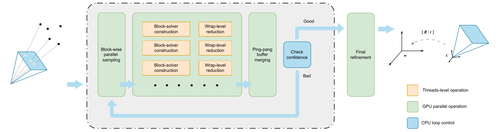

# TurboRANSAC

## 🏠 About

This repository contains the official implementation of **TurboRANSAC: A Fully GPU-Accelerated RANSAC Framework for Robust Estimation**, presented at **IEEE ISCAS 2026**.

**Yifan Chen\*, Feiyang Xin\*, Zhen Yao, Shuhan Wu, and Xin Lou**

ShanghaiTech University · \*Equal contribution

[Paper (PDF)](paper/TurboRANSAC_ISCAS2026.pdf)

TurboRANSAC accelerates robust geometric estimation by parallelizing sampling, hypothesis generation, scoring, and refinement on the GPU. This checkout provides the CUDA implementation and evaluation program for **absolute camera pose estimation from 2D–3D correspondences**, using P3P hypotheses and pose refinement.

[](paper/fig9.pdf)

## 📦 Evaluation

### Requirements and build

- An NVIDIA GPU with compute capability **7.0 or higher** and a compatible CUDA Toolkit and driver.
- A C++17-compatible host compiler.
- CMake **3.22 or newer**.
- Eigen **3.4.0 or newer**.
- [nlohmann/json](https://github.com/nlohmann/json), discoverable by CMake.

From the repository root, configure and build:

```bash
# Replace 86 with your GPU's CUDA compute capability, without the decimal point.
cmake -S . -B build -DCMAKE_BUILD_TYPE=Release -DCMAKE_CUDA_ARCHITECTURES=86
cmake --build build --parallel
```

The build produces the `TbrCudaPnP` static library and the `build/TbrMain/TbrMain` evaluation executable. If dependencies are installed outside the default search paths, pass their installation prefixes through `-DCMAKE_PREFIX_PATH`.

### Evaluation data

The evaluator consumes precomputed 2D–3D correspondences generated by the dense stage of STDLoc on 7-Scenes. Download the [evaluation data (Google Drive)](https://drive.google.com/file/d/1H29GQPX7JLj-UmrRhz9zzMvto1J85jJY/view?usp=drive_link) and place the scene JSON files under `data/7scenes/`:

```text
data/7scenes/
├── chess.json
├── fire.json
├── heads.json
├── office.json
├── pumpkin.json
├── redkitchen.json
└── stairs.json
```

The `data/` directory is excluded from version control.

Each JSON file maps frame names to the following fields:

| Field | Format | Meaning |
| --- | --- | --- |
| `gt_w2c` | 4 × 4 matrix | Ground-truth world-to-camera transform, with `X_camera = R * X_world + t`. |
| `intrinsic K` | 3 × 3 matrix | Pinhole camera intrinsics containing `fx`, `fy`, `cx`, and `cy`. |
| `point pair` | List of `[u, v, X, Y, Z]` rows | Image coordinates in pixels and corresponding world coordinates. |

Provide at least three correspondences per frame. Use meters for world coordinates and pose translations so the reported translation errors are in centimeters. The evaluator uses a pinhole camera model without distortion parameters.

### Run

Run from the `build/` directory so the default data path resolves correctly:

```bash
cd build
./TbrMain/TbrMain
```

To evaluate additional scenes, edit the `scenes` list in [TbrMain/src/main.cu](TbrMain/src/main.cu) and rebuild. The same file defines `data_dir` and `save_predicted_poses`; the runner takes no command-line arguments.

The program prints each estimated pose and a per-scene summary of mean rotation error (degrees), mean camera-center translation error (centimeters), and mean runtime (milliseconds). Runtime is measured around the full `estimate_absolute_pose_cuda()` call, including data transfers and refinement. Set `save_predicted_poses = true` to write world-to-camera predictions to `data/7scenes/<scene>_pred.json`.

## 🔗 Citation

If you use TurboRANSAC in your research, please cite:

```bibtex
@inproceedings{chen2026turboransac,
  title={TurboRANSAC: A Fully GPU-Accelerated RANSAC Framework for Robust Estimation},
  author={Chen, Yifan and Xin, Feiyang and Yao, Zhen and Wu, Shuhan and Lou, Xin},
  booktitle={2026 IEEE International Symposium on Circuits and Systems (ISCAS)},
  pages={4262--4266},
  year={2026},
  organization={IEEE},
  doi={10.1109/ISCAS66217.2026.11562896},
  url={https://ieeexplore.ieee.org/document/11562896/}
}
```

## 👏 Acknowledgements

The TurboRANSAC implementation is heavily inspired by [PoseLib](https://github.com/PoseLib/PoseLib).
